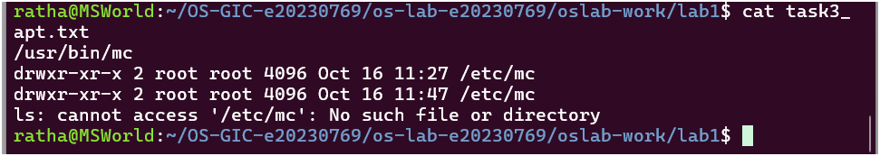
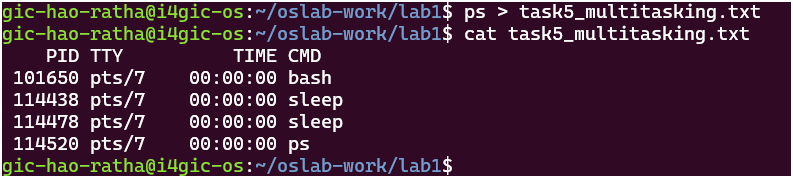
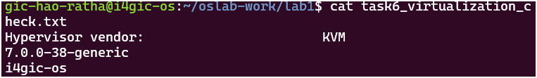

# OS Lab Report: Task 1

**Student Name:** HAO Ratha  
**Student ID:** e20230769  

---

## Task 1  Which System Is This?

### 1. Commands Executed
```bash
uname -a > task1_os_info.txt
lsb_release -a >> task1_os_info.txt
cat task1_os_info.txt
```

### 2. System Specifications Identified
*   **Linux Kernel Version:** `7.0.0-38-generic`
*   **Ubuntu OS Version:** `26.04` (Ubuntu 26.04.1 LTS)

## Task 4: Process Management and Execution

### 1. Commands Executed
```bash
which sleep
sleep 30 &
ps > task4_process_list.txt
cat task4_process_list.txt
ps
```

### 2. Analysis and Observations

*   **Before:** Running `which sleep` shows the absolute
 path of the executable binary. The **program** was located 
 stored on the disk at `/usr/bin/sleep`. At this stage,
  it was just a static file (not a process).
*   **During:** Running `sleep 30 &` executes the program in
 the background, turning it into an active **process** 
 loaded in the RAM. Running `ps` captures this active 
 process with its unique Process ID (PID).
*   **After:** After 30 seconds, the background process 
finishes execution. Running `ps` again confirms that the
 process has terminated and is no longer visible in the 
 process list.

### 3. Key Technical Summary
*   **Program Location (On Disk):** `/usr/bin/sleep`
*   **Process Location (In Memory):** Loaded and active in 
the system **RAM** during the 30-second execution window.

## Task 6: Virtualization Check

### 1. Commands Executed
```bash
systemd-detect-virt > task6_virtualization_check.txt
lscpu | grep -i "hypervisor vendor" >> task6_virtualization_check.txt
uname -r >> task6_virtualization_check.txt
hostname >> task6_virtualization_check.txt
cat task6_virtualization_check.txt
```

### 2. Output and Meaning
*   **First Line Output:** `wsl`
*   **Meaning:** It means the system is running inside a **Virtual Machine** (Windows Subsystem for Linux), not on real physical hardware.

### 3. Summary
*   **Environment:** WSL (Virtual Machine ,KVM)
*   **Hostname:** `i4gic-os`


---

## Task Screenshots

Here are the verification snapshots for each task, located in the `images/` folder:

### Task 3 Screenshot


### Task 5 Screenshot


### Task 6 Screenshot



